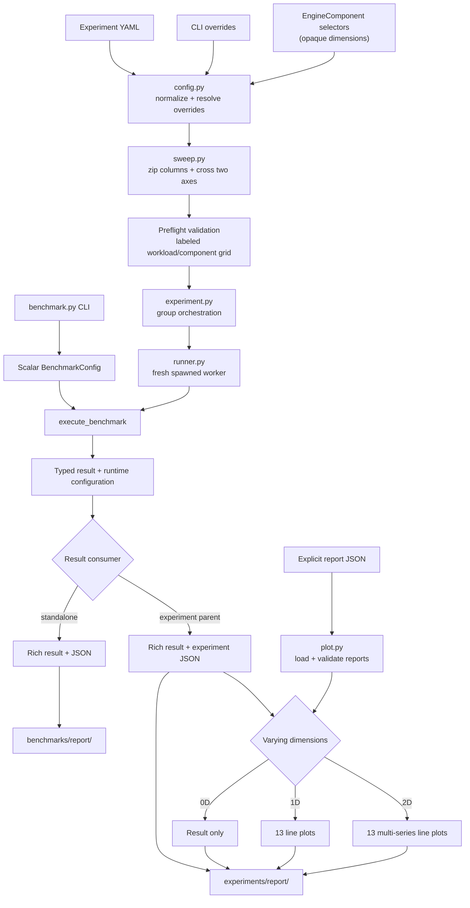

<div align="center">

<h1>Ultra-Nano-vLLM</h1>

<p><strong>Measure. Isolate. Profile. Optimize.</strong></p>
<p>A reproducible performance-research workflow for nano-vLLM.</p>

<p>
  <a href="pyproject.toml"></a>
  <a href="#installation"></a>
  <a href="#research-workflow"></a>
  <a href="LICENSE"></a>
</p>

<p>
  <a href="#architecture">Architecture</a> ·
  <a href="#installation">Installation</a> ·
  <a href="#benchmark">Benchmark</a> ·
  <a href="#experiments">Experiments</a> ·
  <a href="#profiling">Profiling</a> ·
  <a href="#pluggable-design">Pluggable Design</a> ·
  <a href="#research-workflow">Research Workflow</a>
</p>

</div>

Ultra-Nano-vLLM is a performance research project built around
[nano-vLLM](https://github.com/GeeeekExplorer/nano-vllm). It turns a lightweight
inference engine into a controlled environment for measuring changes, profiling
confirmed bottlenecks, and checking optimizations against reproducible baselines.

| Benchmark | Experiment | Optimize |
| --- | --- | --- |
| Record structured latency, throughput, and KV-cache occupancy measurements. | Isolate scalar, component, and kernel effects with validated YAML grids. | Profile confirmed workloads, replace focused implementations, and compare regressions. |

> **Research loop:** benchmark → controlled experiment → profiling → optimization → regression comparison

<a id="architecture"></a>

## Architecture

The research path is deliberately separate from inference-engine details.
Benchmark and experiment entrypoints transport an opaque `EngineComponent`
selection but never decide how an engine component is implemented. See
[Pluggable Design](#pluggable-design) for the replacement contract.



### Source map

| Area | Responsibility |
| --- | --- |
| `benchmarks/benchmark.py` | Defines one scalar benchmark configuration and measurement lifecycle. |
| `benchmarks/runner.py` | Adapts a workload to the LLM API and captures runtime and KV-cache block usage. |
| `experiments/config.py` | Loads YAML, applies overrides, infers dimensions, and validates grids. |
| `experiments/sweep.py` | Zips positional columns per axis, then crosses workloads with component configurations. |
| `experiments/experiment.py` | Orchestrates groups, parent-side reporting, and plot dispatch. |
| `experiments/runner.py` | Runs each scalar configuration in a fresh spawned process. |
| `experiments/plot.py` | Loads reports and renders dimension-specific comparisons. |
| `utils/reporter.py` | Displays Rich output and persists typed JSON reports. |

Architecture invariants:

- Benchmark and experiment entrypoints remain engine-agnostic.
- Each YAML file forms an independent plotting group.
- Complete, unique workload-by-component grids are validated before GPU work.
- Scalar experiment runs are sequential, process-isolated, and request explicit cleanup.
- Typed results return to the parent process for reporting and plotting.
- Plot-only mode reads only the report files explicitly supplied by the user.

<a id="installation"></a>

## Installation

<details open>
<summary><strong>Environment and dependencies</strong></summary>

<br>

Ultra-Nano-vLLM supports Python 3.10–3.12 and requires an NVIDIA GPU, a
compatible CUDA environment, PyTorch, Triton, and FlashAttention. The commands
below target CUDA 12.8; use the command generated by the
[PyTorch installer](https://pytorch.org/get-started/locally/) when your CUDA
environment differs.

```bash
python -m venv .venv
source .venv/bin/activate
python -m pip install --upgrade pip setuptools wheel
python -m pip install torch==2.8.0 --index-url https://download.pytorch.org/whl/cu128
python -m pip install ninja packaging psutil
MAX_JOBS=2 python -m pip install "flash-attn>=2.8.3,<2.9" --no-build-isolation
python -m pip install -e .
```

`MAX_JOBS=2` limits FlashAttention build memory usage and can be adjusted for
your machine.

</details>

<details open>
<summary><strong>Local model setup</strong></summary>

<br>

Benchmarks use a local model path. The included experiment configurations
default to `~/huggingface/Qwen3-0.6B/`. For example:

```bash
huggingface-cli download --resume-download Qwen/Qwen3-0.6B \
  --local-dir ~/huggingface/Qwen3-0.6B/ \
  --local-dir-use-symlinks False
```

</details>

<a id="benchmark"></a>

## Run a benchmark

Use `benchmarks/benchmark.py` for one scalar configuration:

```bash
python benchmarks/benchmark.py \
  --model ~/huggingface/Qwen3-0.6B/ \
  --num-requests 256 \
  --input-len 1024 \
  --output-len 256 \
  --max-model-len 8192 \
  --temperature 0 \
  --repeats 3 \
  --experiment-name baseline
```

`temperature: 0` selects greedy decoding. Positive temperatures use stochastic
sampling. Add `--enforce-eager` to disable CUDA graph execution.
`input_len + output_len` must not exceed `max_model_len`. The engine also caps
the effective value at the model's `max_position_embeddings`. The field defaults
to `8192` when omitted; repository experiment configs also set it explicitly.
Use `--alternate-input-len` to make every second request use a different prompt
length. Both prompt lengths are checked against the requested and effective
maximum model length before warmup begins.
Use `--input-order alternating`, `primary-first`, or `alternate-first` to
control whether the two prompt-length cohorts are interleaved or grouped. A
non-default order requires `--alternate-input-len`.

The benchmark prints a Rich result table and writes a JSON report under
`benchmarks/report/`. Each report includes workload totals, median/minimum/
maximum/mean/standard-deviation summaries, request latency p50/p90/p99,
prefill/decode time and throughput, peak used KV-cache blocks, and peak KV-cache
utilization.

<a id="experiments"></a>

## Run controlled experiments

An experiment YAML defines two independent sets of positional columns. All
non-component fields are zipped into workload columns, while the five component
selectors are zipped into component columns. Scalars and one-element lists are
broadcast within their set; every other list must match that set's column count.
The two sets are then crossed, with each workload running against every component
configuration.

```yaml
model: ~/huggingface/Qwen3-0.6B/
workload_name: [input-512, input-1024]
num_requests: 256
input_len: [512, 1024]
output_len: 256
max_model_len: 8192
seed: 0
temperature: 0
repeats: 3
enforce_eager: false

component_name: [baseline, scheduler-v1, scheduler-v2]
scheduler: [scheduler, scheduler-v1, scheduler-v2]
block_manager: block_manager
attention: attention
sampler: sampler
store_kvcache: store_kvcache
```

This produces six runs in workload-first order, with `baseline`, `scheduler-v1`,
and `scheduler-v2` evaluated for each input length. The final run name
is always `<component_name>-<workload_name>`. Labels are required and must be
unique whenever their set has more than one column; single-column sets default
to `workload` and `baseline`.

Run it with:

```bash
python experiments/experiment.py --config experiments/configs/your-config.yaml
```

Pass `--config` repeatedly to execute multiple YAML files. Each file remains an
independent plotting group:

```bash
python experiments/experiment.py \
  --config experiments/configs/scheduler-comparison-minimal.yaml \
  --config experiments/configs/scheduler-comparison-hol-kv.yaml
```

### Included experiment configurations

The repository currently includes two three-scheduler comparisons. Both use
Qwen3-0.6B, greedy decoding, CUDA Graph execution, a maximum model length of
8192 tokens, and ten measured repeats with seeds 1--10.

| Config | Workloads | Purpose |
| --- | --- | --- |
| `scheduler-comparison-minimal.yaml` | Nine 33-request batches with 256-token short prompts and optional 1024--6144-token long prompts | Isolate prefill head-of-line effects across short-only, long-first, alternating, and short-first queue orders. |
| `scheduler-comparison-hol-kv.yaml` | Seven long-first mixed-length batches with 45--57 requests and 128-token outputs | Exercise decode and admission behavior as KV-cache pressure increases. |

`scheduler-comparison-minimal.yaml` names each workload according to its queue
shape. `hol-short-only` contains only 256-token prompts.
`hol-long-first-L` places the `L`-token cohort before the short cohort, where
`L` is 1024, 2048, 3072, 4096, 5120, or 6144. `hol-alternating-4096`
interleaves the 256- and 4096-token cohorts, while `hol-short-first-4096`
places the short cohort first.

`scheduler-comparison-hol-kv.yaml` holds the mixed 256/4096-token long-first
prompt shape and 128-token output length fixed while increasing request count.
Its labels describe the intended pressure points, from `kv-fit-45` through
`kv-higher-pressure-57`; the numeric suffix is the request count.

Benchmark CLI options can override scalar YAML values for the invocation:

```bash
python experiments/experiment.py \
  --config experiments/configs/scheduler-comparison-minimal.yaml \
  --temperature 0 \
  --repeats 5
```

Experiment groups have up to two conceptual dimensions: workload and component.
Column lengths, resolved configuration uniqueness, the complete cross-product,
and globally unique generated experiment names are validated before any GPU work
begins. The removed YAML field `experiment_name` is rejected; use
`workload_name` and `component_name` instead. Every scalar configuration runs
sequentially in a fresh
spawned process so CUDA graph pools, cached allocations, and NCCL process-group
state cannot leak into the next measurement.

Reports and PNG plots are written to `experiments/report/`:

- 0 varying dimensions: Rich result and JSON report only.
- 1 varying dimension: thirteen mean line charts over workload or component
  labels; summarized metrics include standard-deviation bands.
- 2 varying dimensions: thirteen multi-series mean line charts with workload on
  the x-axis and component configuration in the legend. Summarized metrics
  include independent standard-deviation bands for every series.

The thirteen plotted metrics cover elapsed time, latency p50/p90/p99, request,
output, total, prefill, and decode throughput, prefill/decode time, and the two
KV-cache occupancy metrics. Output and total throughput remain available because
they describe end-to-end serving rates rather than phase-local execution rates.

Existing experiment reports can be plotted again without running the model:

```bash
python experiments/experiment.py --plot-only \
  experiments/report/run-a.json \
  experiments/report/run-b.json
```

### Scheduler comparison suite

Both included configurations compare the baseline `scheduler`, `scheduler-v1`,
and `scheduler-v2` in a fixed order while holding the block manager, attention,
sampler, and store-KV-cache kernel constant:

```bash
python experiments/experiment.py \
  --config experiments/configs/scheduler-comparison-minimal.yaml \
  --config experiments/configs/scheduler-comparison-hol-kv.yaml
```

Each group produces thirteen charts. Every chart places workload on the x-axis
and draws all three schedulers together: baseline is a blue circle line, v1 is
an orange square line, and v2 is a green triangle line. Uncertainty bands reuse
their line color and the complete selector legend is outside the data area.

Each measured repeat also stores request-aligned latencies and input lengths, an
output digest, and scheduler telemetry. Pass all explicit JSON report paths to
the dedicated analyzer:

```bash
python experiments/analyze_scheduler.py \
  --reports path/to/baseline-report.json path/to/v1-report.json \
    path/to/v2-report.json ... \
  --reference-selector scheduler \
  --candidate-selectors scheduler-v1 scheduler-v2 \
  --output-dir "experiments/report/scheduler-comparison"
```

The analyzer pairs each candidate with the baseline at equal seeds, excludes a
candidate pair when its token totals or output digest differ, computes
10,000-sample bootstrap confidence intervals, and writes a combined Markdown,
CSV, Pareto figure, and three-scheduler mechanism figure.

The baseline scheduler processes waiting requests in first-come, first-served
order and stops when the next prefill cannot join the current batch.
`scheduler-v1` scans the waiting queue once, defers candidates that do not fit,
and can backfill remaining capacity with a later request. `scheduler-v2`
stably sorts waiting requests by remaining prefill tokens before applying the
same single-pass deferred scan. This shortest-remaining-job-first policy moves
short prefills ahead of long prefills while preserving the order of equal-size
requests.

Only the explicitly listed reports form the plotting group. They must contain
compatible `experiment_config` and result payloads. Reports containing only the
legacy GPU allocator peak fields or lacking latency/phase metrics must be
regenerated before using plot-only mode.

<a id="profiling"></a>

## Profiling

Profile only after a benchmark or controlled experiment has isolated a stable
workload worth investigating. Keep the model, request count, input and output
lengths, sampling settings, execution mode, and component selections fixed so
the trace describes the same configuration as the saved baseline.

Use the following workflow with any profiler that can capture the CPU and GPU
activity relevant to the workload:

1. Warm up the engine before interpreting the trace. Separate initialization,
   model loading, compilation, and CUDA graph capture from steady-state work.
2. Analyze prefill and decode independently. Prefill processes many prompt
   tokens in parallel, while decode repeatedly processes a smaller token step;
   their bottlenecks and useful comparisons are different.
3. Correlate host activity with GPU kernels. Look for launch gaps,
   synchronization, unexpected serialization, excessive short kernels, and
   memory-transfer or allocation activity before attributing cost to a model
   component.
4. Form one bottleneck hypothesis at a time, make a focused change, and re-run
   the same scalar configuration. A trace explains where time is spent; the
   comparable benchmark result determines whether the change is an improvement.

Optional NVTX annotations make the engine stages easier to correlate in tools
that support them. Set `ENABLE_NVTX=1` in the benchmark or experiment process
environment to emit ranges for scheduler operations, block allocation and
deallocation, prefill/decode/sample input preparation, attention, KV-cache
storage, and logits computation. When the variable is unset or has any other
value, the wrappers do not open CUDA NVTX ranges.

Profiling measurements may include collection overhead and should not replace
the uninstrumented benchmark reports used for performance comparisons. The
project intentionally does not require a particular profiler or prescribe a
location for generated profiling artifacts.

<a id="pluggable-design"></a>

## Pluggable components and kernels

`EngineComponent` keeps the benchmark and experiment entrypoints independent of
inference-engine implementation details. Each selector is a safe local filename
stem in a fixed role directory; hyphenated names such as
`my-scheduler-v1.py` are supported, while paths and `..` are rejected.

<details>
<summary><strong>Implementation contract and Python API</strong></summary>

<br>

| YAML selector | Implementation location | Required factory |
| --- | --- | --- |
| `scheduler` | `nanovllm/engine/scheduler/<selector>.py` | `create_component(config=..., block_manager=...)` |
| `block_manager` | `nanovllm/engine/block_manager/<selector>.py` | `create_component(num_blocks=..., block_size=...)` |
| `attention` | `nanovllm/layers/attention/<selector>.py` | `create_component(num_heads=..., head_dim=..., scale=..., num_kv_heads=..., store_kvcache=...)` |
| `sampler` | `nanovllm/layers/sampler/<selector>.py` | `create_component()` |
| `store_kvcache` | `nanovllm/kernels/store_kvcache/<selector>.py` | `create_kernel()` |

Factory results must satisfy the runtime-checkable Protocol for their role in
`nanovllm.engine.component`. The attention factory receives the selected
store-KV-cache callable, so Triton or CUDA kernel wrappers can participate in
the same replacement mechanism. Omitted selectors use the baseline filenames
shown in the YAML example above.

To compare a new scheduler, first add
`nanovllm/engine/scheduler/my-scheduler-v1.py` with the required factory, then
configure the categorical sweep:

```yaml
scheduler: [scheduler, my-scheduler-v1]
block_manager: block_manager
attention: attention
sampler: sampler
store_kvcache: store_kvcache
```

`my-scheduler-v1` is an illustrative name, not a bundled implementation. The
same convention applies to the other component and kernel directories.

The selection API is also available to Python callers:

```python
from nanovllm import EngineComponent, LLM

components = EngineComponent(scheduler="my-scheduler-v1")
llm = LLM(
    "/YOUR/MODEL/PATH",
    enforce_eager=True,
    tensor_parallel_size=1,
    engine_component=components,
)
```

</details>

<a id="research-workflow"></a>

## Research workflow

1. Establish a reproducible scalar benchmark for the workload of interest.
2. Use a one- or two-dimensional experiment to isolate the relevant effect.
3. Profile the confirmed workload and identify the actual bottleneck.
4. Add a focused component, kernel, or engine optimization while preserving
   correctness and public behavior.
5. Re-run the same benchmark grid and compare the saved reports for performance
   improvement and regressions.

The repository does not mandate a profiling framework. It provides optional
NVTX instrumentation for compatible tools while leaving profiler selection,
commands, and artifact storage to the investigation.

<details>
<summary><strong>Development verification</strong></summary>

<br>

Prefer the repository virtual environment when it exists:

```bash
.venv/bin/python -m compileall -q benchmarks experiments nanovllm utils
git diff --check
```

Use `python3` instead of `.venv/bin/python` when the virtual environment is not
available. Do not run real benchmarks without a suitable NVIDIA GPU, CUDA
environment, and local model.

Generated output under `benchmarks/report/` and `experiments/report/` should
remain untracked.

</details>

## Relationship to nano-vLLM

Ultra-Nano-vLLM is built on the lightweight inference engine from
[GeeeekExplorer/nano-vllm](https://github.com/GeeeekExplorer/nano-vllm). The
upstream project provides the readable nano-vLLM implementation; this repository
adds the benchmark, controlled experiment, reporting, plotting, isolation, and
pluggable-selection infrastructure needed for an evidence-driven optimization
workflow.

See [LICENSE](LICENSE) for licensing information.
